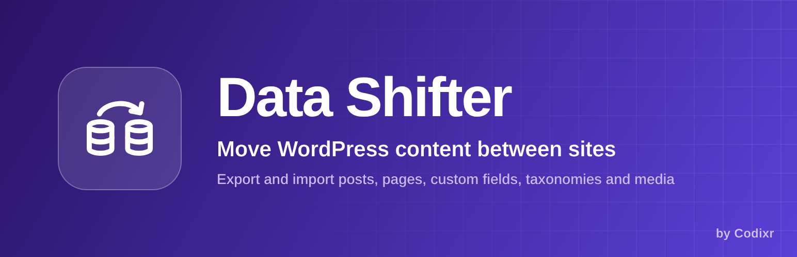
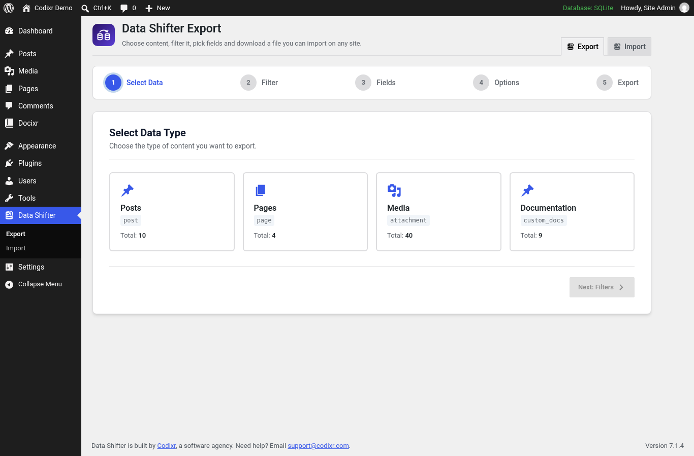
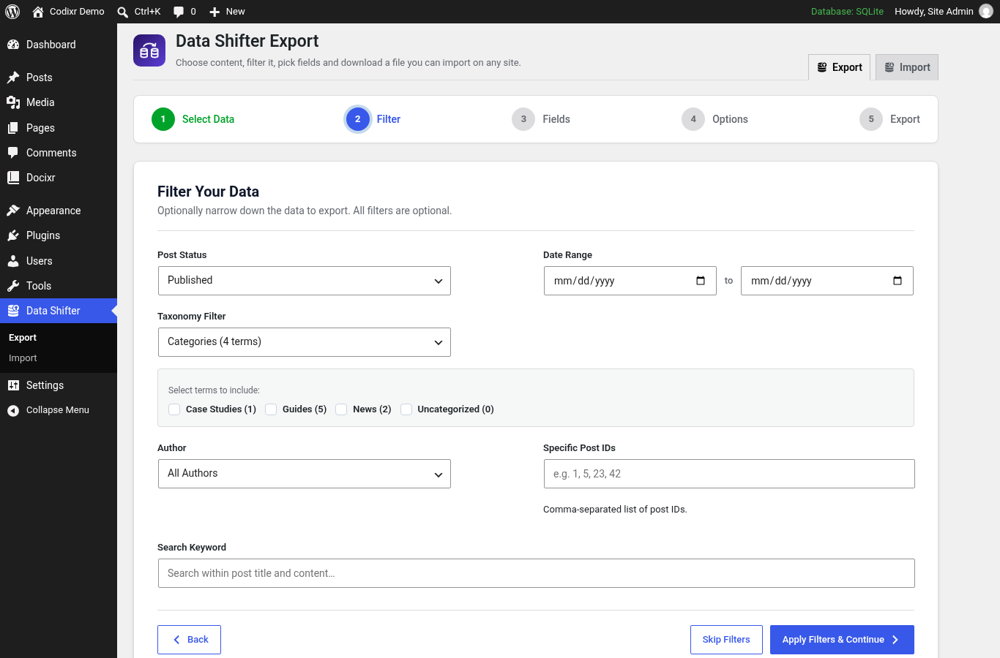
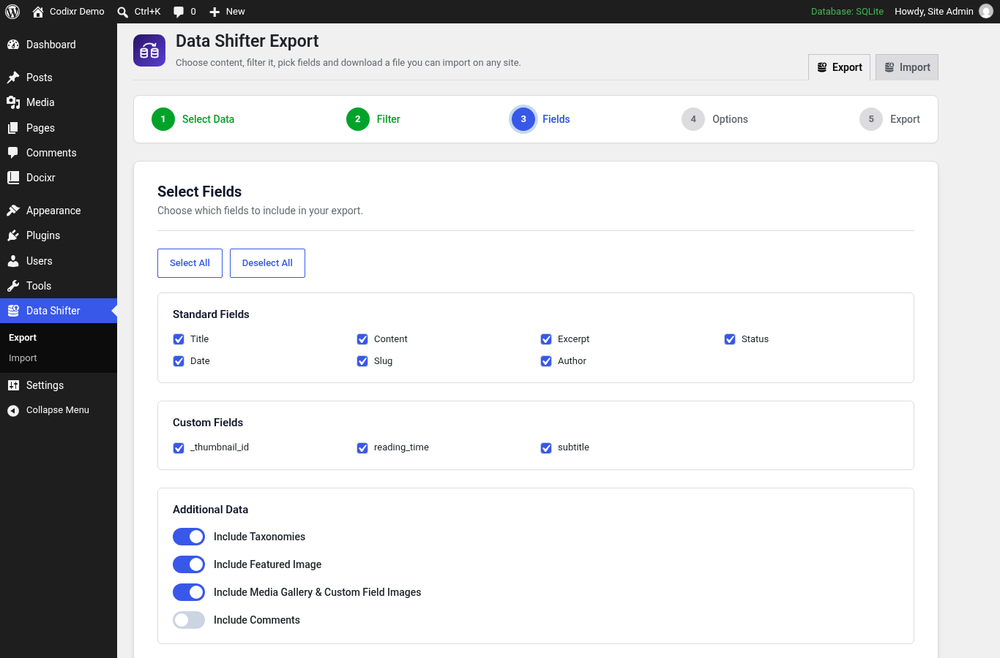
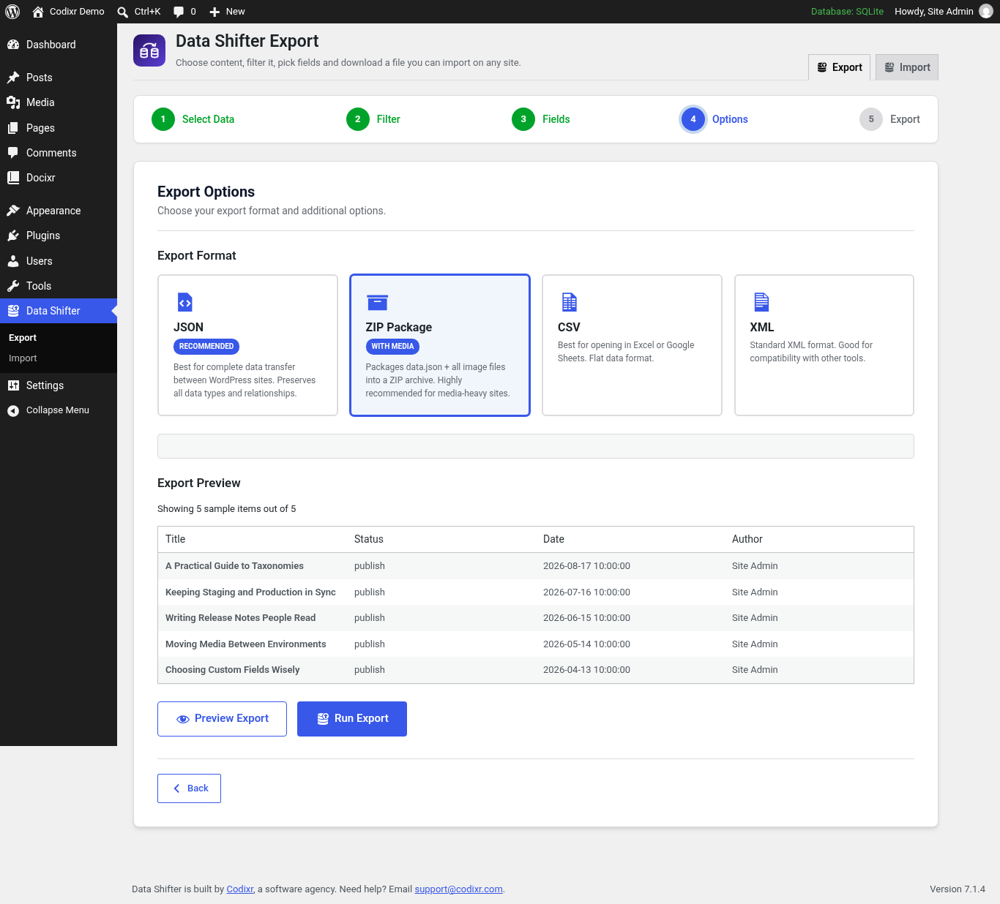
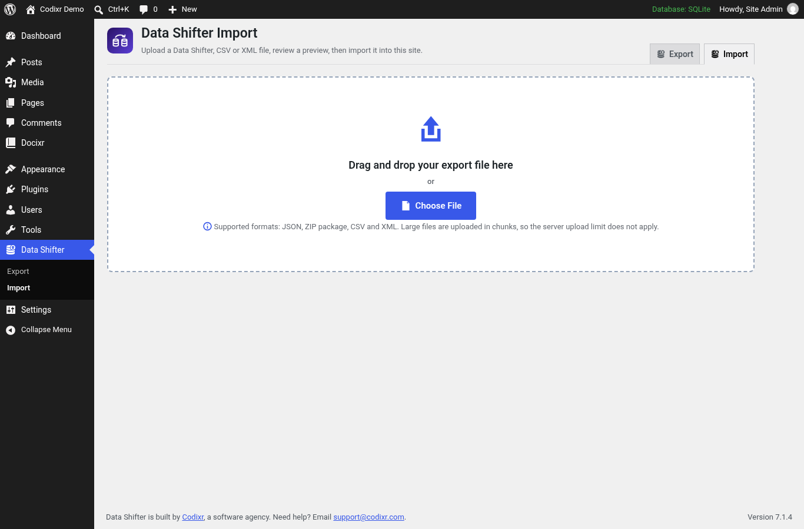
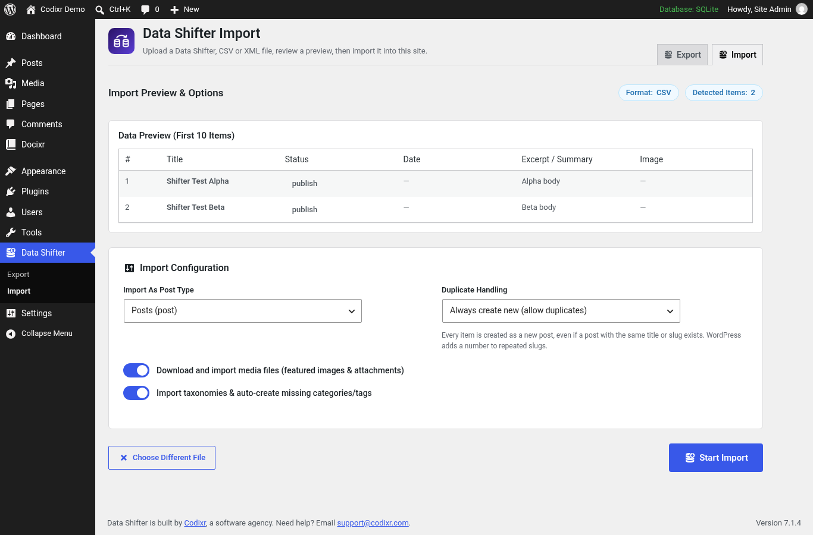
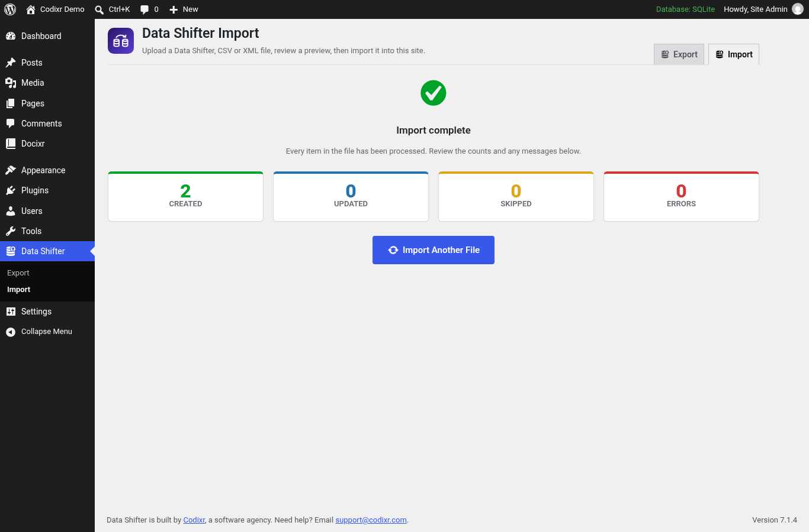

# Data Shifter

  

Export and import WordPress content between sites — posts, pages, custom post types, custom fields, taxonomies, comments and media — as JSON, a ZIP package with media files, CSV or XML.

A step-by-step export screen lets you pick what to export, and a drag-and-drop import screen shows a preview before anything is written to your database.

> **WordPress.org status:** Data Shifter has been submitted to the WordPress.org plugin directory and is currently awaiting review. Until it is approved, install it from the release ZIP on this repository (see [Installation](#installation)).

## Features

### Export

- Any public post type, including pages and custom post types
- Filters by status, date range, author and taxonomy term
- Choose which custom fields to include, with internal fields kept separate
- Optional taxonomies, featured images, galleries and comments
- Output as JSON, a ZIP package with media files, CSV or XML
- Preview sample rows before you run the export

### Import

- Drag and drop a Data Shifter JSON or ZIP file, a CSV or an XML file
- Large files are uploaded in chunks, so the server upload limit does not get in the way
- Preview the first ten items before importing
- Import as any post type, and choose to skip existing posts, update them (matched by title or slug), or always create new posts
- Optional media import and automatic creation of missing categories and tags
- Imports run in small batches with a progress bar, and a summary of created, updated, skipped and failed items

Data Shifter does not send any data to Codixr or to any other service, and it does not track usage.

## Screenshots

**Export, step 1:** choose the content type to export.

**Export, step 2:** filter by status, date, author and taxonomy.

**Export, step 3:** choose fields and custom fields.

**Export, step 4:** pick the format and run the export.

**Import:** drag and drop an export file.

**Import:** preview the file and set import options.

**Import:** summary of created, updated, skipped and failed items.

## Requirements

- WordPress 5.0 or later (tested up to 7.1)
- PHP 7.4 or later
- Administrator access (`manage_options`) to use the plugin

## Installation

### From a release ZIP (recommended)

1. Download `data-shifter-1.0.0.zip` from the [Releases](../../releases) page of this repository.
2. In your WordPress admin, go to **Plugins → Add New → Upload Plugin**, choose the ZIP file and click **Install Now**.
3. Activate the plugin.
4. Open **Data Shifter** in the admin menu. Use the **Export** tab on the source site and the **Import** tab on the destination site.

### Manual install

1. Download `data-shifter-1.0.0.zip` from the Releases page and unzip it.
2. Upload the `data-shifter` folder to `wp-content/plugins/` on your site (for example with SFTP).
3. In the WordPress admin, go to **Plugins** and activate **Data Shifter**.
4. Open **Data Shifter** in the admin menu.

Only administrators (users with the `manage_options` capability) can use Data Shifter.

## Usage

### Exporting content

1. Open **Data Shifter** in the WordPress admin and stay on the **Export** tab.
2. Choose the content type (any public post type, including pages and custom post types).
3. Optionally filter by status, date range, author and taxonomy term.
4. Choose which fields and custom fields to include, and whether to include taxonomies, featured images, galleries and comments.
5. Preview sample rows if you want to check the output.
6. Choose a format — JSON, ZIP (with media files), CSV or XML — and run the export.
7. Download the file when the export finishes.

Export files are stored briefly in `wp-content/uploads/data-shifter/temp/` (protected from direct browsing) and are deleted after download.

### Importing content

1. On the destination site, open **Data Shifter** and go to the **Import** tab.
2. Drag and drop a Data Shifter JSON or ZIP file, or a CSV or XML file. Large files are uploaded in chunks.
3. Preview the first ten items.
4. Choose the post type to import as, how to handle existing posts (skip, update by title or slug, or always create new), and whether to import media and create missing categories and tags.
5. Run the import and leave the browser tab open until it finishes. A progress bar and a summary of created, updated, skipped and failed items are shown.

When “Download and import media files” is turned on, Data Shifter downloads each image from the URL stored in the file, unless the image data is already bundled in a ZIP package. These requests go only to the addresses listed in your import file. Turn the option off to import without any outgoing requests.

**Take a backup before importing into a live site.** Imports write directly to your database and cannot be undone.

### CSV columns

For CSV files, use column names such as Title, Content, Excerpt, Status, Date, Slug, Categories, Tags and Image. Other columns are imported as custom fields.

## Frequently Asked Questions

**Which formats can I import?**

Data Shifter JSON and ZIP files, plus CSV and XML files. For CSV, use column names such as Title, Content, Excerpt, Status, Date, Slug, Categories, Tags and Image. Other columns are imported as custom fields.

**Does it work with very large files?**

Yes. Files are uploaded in chunks and imported in batches, so large exports work on most hosts. Very large media libraries can still take a while, so keep the browser tab open until the import finishes.

**What happens to posts that already exist?**

You choose. Data Shifter can skip them or update them, matching existing posts by title or by slug. You can also choose “Always create new”, which creates every item as a new post even when a matching post exists; WordPress adds a number to repeated slugs.

**Are images copied too?**

Yes. ZIP exports include the media files. JSON, CSV and XML imports can download images from the URLs in the file when media import is turned on.

**Can I undo an import?**

No. Imports write directly to your database, so take a backup before importing into a live site.

**Where can I get help?**

Email [support@codixr.com](mailto:support@codixr.com) or visit [codixr.com](https://codixr.com).

## Contributing

Issues and pull requests are welcome.

- Please keep changes focused and describe what you changed and why.
- Follow the [WordPress Coding Standards](https://developer.wordpress.org/coding-standards/).
- This plugin has no build step. The admin JavaScript and CSS in `assets/` are used as-is; edit those files directly.
- If you update translatable strings, refresh `languages/data-shifter.pot`.

For support rather than a code change, email [support@codixr.com](mailto:support@codixr.com).

## Changelog

See [CHANGELOG.md](CHANGELOG.md) for the full history.

### 1.0.0

- Initial release.

## License

Data Shifter is free software, licensed under the [GNU General Public License v2.0 or later](LICENSE).

---

Made by [Codixr](https://codixr.com), a software agency.
